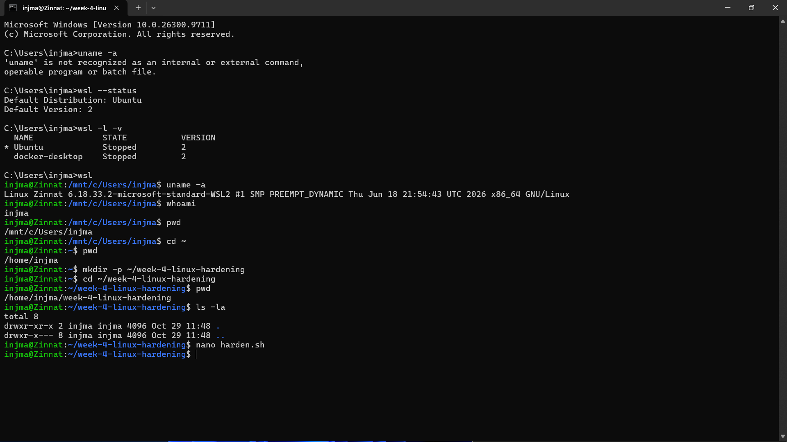
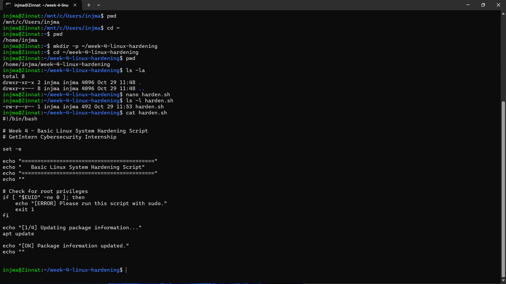
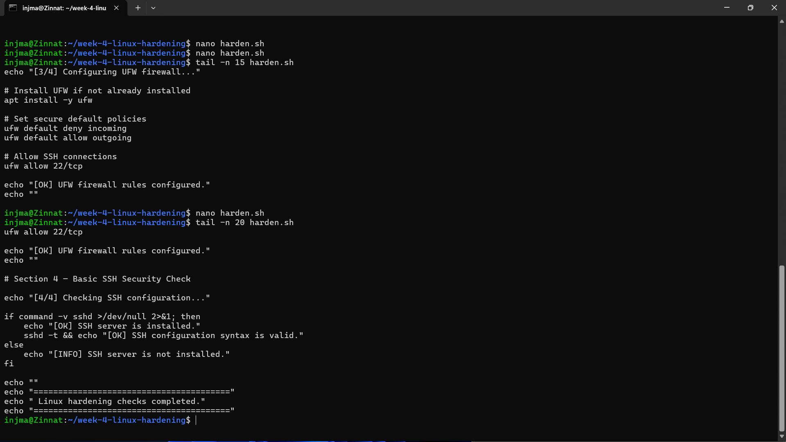
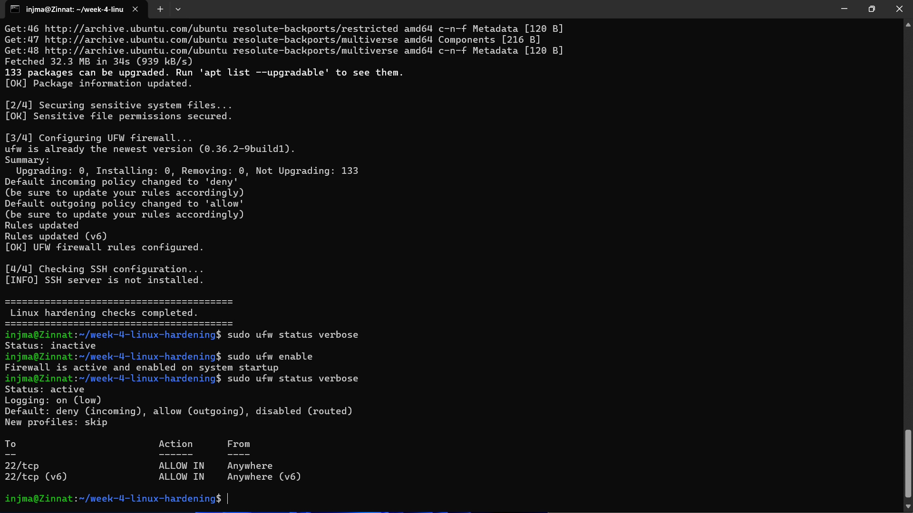

# 🔐 Week 4 — Linux System Hardening

<p align="center">


</p>

<p align="center">
  <strong>Practical Linux Security Hardening using Bash Automation</strong>
</p>

<p align="center">
  GetIntern — Cybersecurity Internship | Week 4
</p>

---

## 📌 Project Overview

This project demonstrates **basic Linux system hardening** using a Bash automation script on **Ubuntu Linux running inside WSL2**.

The objective is to improve the security posture of a Linux environment by applying a small set of practical defensive controls:

- Updating package information
- Securing sensitive system file permissions
- Configuring the UFW firewall
- Applying restrictive default firewall policies
- Allowing required SSH traffic
- Checking SSH server configuration syntax
- Verifying the resulting security configuration

The project follows a simple defensive-security workflow:

> **Identify → Harden → Verify → Document**

The implementation was performed in a controlled personal WSL2 environment as part of cybersecurity internship training.

---

## 🎯 Objectives

The main objectives of this task were:

1. Understand the fundamentals of Linux system hardening.
2. Automate repetitive security configuration using Bash.
3. Protect sensitive authentication-related files.
4. Configure a host-based firewall using UFW.
5. Reduce unnecessary inbound network exposure.
6. Understand the role of SSH in Linux administration.
7. Verify security configurations after applying changes.
8. Document the complete process for reproducibility.

---

## 🧠 What is Linux System Hardening?

**Linux system hardening** is the process of improving the security of a Linux system by reducing unnecessary exposure, restricting access, protecting sensitive resources, and applying secure configuration practices.

A hardened system aims to:

- Reduce the attack surface
- Prevent unauthorized access
- Protect sensitive configuration and authentication files
- Restrict unnecessary network traffic
- Maintain secure system configurations
- Improve overall defensive security posture

Hardening is not a single action. It is a combination of multiple security controls.

---

# 🏗️ Environment

| Component | Details |
|---|---|
| Operating System | Ubuntu Linux |
| Environment | WSL2 |
| Shell | Bash |
| Firewall | UFW |
| Remote Access | OpenSSH |
| Version Control | Git |
| Repository | GitHub |
| Training | GetIntern Cybersecurity Internship |
| Task | Week 4 — Linux System Hardening |

---

# 🛠️ Tools Used

- **Ubuntu Linux** — Target Linux environment
- **WSL2** — Linux environment on Windows
- **Bash** — Automation and scripting
- **UFW** — Host-based firewall
- **OpenSSH** — SSH security/configuration verification
- **Git** — Version control
- **GitHub** — Project hosting and documentation

---

# 📁 Project Structure

```text
week-4-linux-hardening/
│
├── README.md
├── harden.sh
│
└── screenshots/
    ├── 01-system-info.png
    ├── 02-hardening-script.png
    ├── 03-hardening-execution.png
    └── 04-ufs-status.png
```

### File Description

| File | Purpose |
|---|---|
| `harden.sh` | Main Linux hardening Bash script |
| `README.md` | Project documentation |
| `screenshots/` | Evidence collected during the practical implementation |

---

# 🔐 Hardening Methodology

The hardening script performs four primary security operations.

```text
                Linux System
                     │
                     ▼
             Root Privilege Check
                     │
                     ▼
          ┌──────────────────────┐
          │ 1. Package Update    │
          └──────────────────────┘
                     │
                     ▼
          ┌──────────────────────┐
          │ 2. File Permissions  │
          └──────────────────────┘
                     │
                     ▼
          ┌──────────────────────┐
          │ 3. UFW Firewall      │
          └──────────────────────┘
                     │
                     ▼
          ┌──────────────────────┐
          │ 4. SSH Configuration │
          │       Check          │
          └──────────────────────┘
                     │
                     ▼
               Verification
```

---

# 1️⃣ Root Privilege Verification

The script first verifies that it is being executed with administrative privileges.

```bash
if [ "$EUID" -ne 0 ]; then
    echo "[ERROR] Please run this script with sudo."
    exit 1
fi
```

### Why?

Several hardening operations modify protected system resources.

For example:

- `/etc/passwd`
- `/etc/shadow`
- `/etc/group`
- `/etc/gshadow`
- UFW firewall configuration

Therefore, administrative privileges are required.

### Execution

```bash
sudo ./harden.sh
```

If the script is executed without sufficient privileges, it stops instead of continuing with incomplete security changes.

---

# 2️⃣ Package Information Update

The script updates the local package information before performing the remaining tasks.

```bash
apt update
```

### Why?

Keeping package information current helps the system identify available package updates and security-related changes.

The script reports:

```text
[1/4] Updating package information...
[OK] Package information updated.
```

> **Note:** `apt update` refreshes package metadata. It does not itself upgrade installed packages.

---

# 3️⃣ Secure Sensitive System Files

Linux authentication and account-management information is stored in important system files.

The script applies the following permissions:

```bash
chmod 644 /etc/passwd
chmod 640 /etc/shadow
chmod 644 /etc/group
chmod 640 /etc/gshadow
```

### Permission Table

| File | Permission | Purpose |
|---|---:|---|
| `/etc/passwd` | `644` | User account information |
| `/etc/shadow` | `640` | Protected password information |
| `/etc/group` | `644` | Group information |
| `/etc/gshadow` | `640` | Protected group authentication information |

### Security Principle

The objective is to prevent unauthorized modification of sensitive authentication-related files.

This follows the security principle of:

> **Least Privilege**

Users and processes should have only the permissions required for their legitimate operations.

---

# 4️⃣ UFW Firewall Configuration

The script installs UFW if necessary:

```bash
apt install -y ufw
```

UFW (**Uncomplicated Firewall**) provides a simple interface for managing Linux firewall rules.

---

## 🔒 Default Firewall Policies

The script applies:

```bash
ufw default deny incoming
ufw default allow outgoing
```

### Meaning

| Traffic | Policy |
|---|---|
| Incoming | ❌ Denied by default |
| Outgoing | ✅ Allowed by default |

This follows a **default-deny inbound** security model.

Instead of allowing every incoming connection, only explicitly permitted services should be accessible.

---

## 🔑 Allow SSH

SSH uses TCP port `22`.

The script allows SSH traffic:

```bash
ufw allow 22/tcp
```

This prevents the firewall from blocking standard SSH access when SSH is required.

---

## Firewall Concept

```text
                 Internet / Network
                         │
                         ▼
                ┌────────────────┐
                │      UFW       │
                │    Firewall    │
                └────────────────┘
                   │           │
             Allowed          Denied
                   │           │
                   ▼           ▼
                SSH :22    Other inbound
```

---

# 5️⃣ SSH Configuration Check

The final stage checks whether the SSH server is installed.

```bash
if command -v sshd >/dev/null 2>&1; then
    echo "[OK] SSH server is installed."
    sshd -t && echo "[OK] SSH configuration syntax is valid."
else
    echo "[INFO] SSH server is not installed."
fi
```

If `sshd` is available, the script uses:

```bash
sshd -t
```

to validate SSH configuration syntax.

### Why is this useful?

A configuration syntax check can help detect invalid SSH configuration before attempting to use the service.

In the WSL2 environment used for this task, the script reported that the SSH server was not installed.

---

# ▶️ How to Run

## Step 1 — Clone the repository

```bash
git clone https://github.com/injmam089/week-4-linux-hardening.git
```

## Step 2 — Enter the project directory

```bash
cd week-4-linux-hardening
```

## Step 3 — Make the script executable

```bash
chmod +x harden.sh
```

## Step 4 — Execute with sudo

```bash
sudo ./harden.sh
```

---

# 🧪 Verification

After execution, the configuration can be verified manually.

### Check current user

```bash
whoami
```

### Check current directory

```bash
pwd
```

### Check project files

```bash
ls -la
```

### Check script permissions

```bash
ls -l harden.sh
```

### Review script

```bash
cat harden.sh
```

### Check UFW status

```bash
sudo ufw status verbose
```

---

# 📊 Expected Firewall Configuration

The intended firewall policy is:

```text
Status: active

Default: deny incoming
Default: allow outgoing

22/tcp    ALLOW IN
```

The exact output may vary depending on the Linux/WSL configuration.

---

# 📸 Evidence & Screenshots

The project includes screenshots documenting the practical implementation.

### 01 — System Information

Demonstrates the Linux/WSL environment used for the task.



---

### 02 — Hardening Script

Shows the Bash hardening script and its security operations.



---

### 03 — Hardening Execution

Shows the execution of the hardening script and its output.



---

### 04 — UFW Status

Shows the resulting firewall configuration/status.



---

# 🔍 Security Controls Implemented

| Security Control | Implementation | Status |
|---|---|---|
| Administrative privilege check | `$EUID` validation | ✅ |
| Package metadata update | `apt update` | ✅ |
| `/etc/passwd` permissions | `chmod 644` | ✅ |
| `/etc/shadow` permissions | `chmod 640` | ✅ |
| `/etc/group` permissions | `chmod 644` | ✅ |
| `/etc/gshadow` permissions | `chmod 640` | ✅ |
| UFW installation | `apt install -y ufw` | ✅ |
| Default inbound policy | `deny incoming` | ✅ |
| Default outbound policy | `allow outgoing` | ✅ |
| SSH port allowance | `22/tcp` | ✅ |
| SSH installation check | `command -v sshd` | ✅ |
| SSH syntax validation | `sshd -t` | ✅ when SSH is installed |

---

# 🧠 Security Concepts Learned

Through this practical task, the following cybersecurity concepts were applied:

### 1. Attack Surface Reduction

Reducing unnecessary network exposure decreases potential entry points.

### 2. Least Privilege

Sensitive files should not be writable by unauthorized users.

### 3. Defense in Depth

Security should use multiple controls rather than depending on one mechanism.

### 4. Secure Defaults

Blocking incoming traffic by default provides a stronger baseline than unrestricted inbound access.

### 5. Configuration Validation

Security configurations should be checked after modification.

### 6. Security Automation

Bash scripting can automate repeatable administrative security tasks.

---

# ⚠️ Important Security Considerations

This script is designed as a **learning and demonstration project**, not as a complete production Linux hardening framework.

Before applying hardening scripts to production systems, administrators should:

- Review every command.
- Understand the services running on the system.
- Back up important configurations.
- Test firewall rules.
- Verify required network services.
- Maintain an alternative administrative access method.
- Review SSH requirements before changing SSH policies.
- Test changes in a staging environment first.

> **Never blindly run a security-hardening script on a production server.**

A firewall rule or permission change can unintentionally disrupt required services.

---

# 🚧 Current Scope & Limitations

This project intentionally focuses on **basic Linux hardening fundamentals**.

It does not currently implement advanced controls such as:

- Fail2Ban
- SELinux/AppArmor policy configuration
- Auditd rules
- Kernel `sysctl` hardening
- Automatic security upgrades
- Password policy enforcement
- SSH key deployment
- Intrusion detection
- File integrity monitoring
- Centralized logging
- CIS benchmark automation
- Automated rollback

These are potential areas for future improvement.

---

# 🔮 Future Improvements

Possible future versions could introduce:

```text
v2.0
├── SSH hardening
├── Password policy checks
├── Auditd configuration
├── Kernel/sysctl hardening
├── Fail2Ban integration
├── Security audit report
├── Logging
├── Backup & rollback
└── CIS benchmark mapping
```

The goal would be to evolve the project from a basic educational script into a more comprehensive Linux security baseline tool.

---

# 📚 Learning Outcome

This project provided practical exposure to:

- Linux administration
- Bash scripting
- File permissions
- Linux authentication files
- Host-based firewalls
- UFW configuration
- SSH security concepts
- Privilege management
- Security verification
- Git and GitHub workflow
- Cybersecurity documentation

The most important takeaway was that **system hardening is not about adding a single security feature; it is about systematically reducing unnecessary risk while maintaining required functionality.**

---

# 🏁 Conclusion

The Week 4 practical successfully demonstrated a basic Linux hardening workflow using Bash on Ubuntu/WSL2.

The implementation:

- Verified administrative privileges
- Updated package information
- Secured sensitive system-file permissions
- Configured UFW with restrictive inbound defaults
- Allowed SSH traffic on TCP port 22
- Checked SSH availability and configuration syntax
- Documented the implementation with screenshots

This project forms a practical foundation for progressing toward more advanced Linux security, system auditing, and defensive cybersecurity techniques.

---

# 👨‍💻 Author

**Injmam**

Cybersecurity Intern — GetIntern

Week 4 — Linux System Hardening

---

## 🔗 Repository

**GitHub:**  
https://github.com/injmam089/week-4-linux-hardening

---

## ⚖️ Disclaimer

This project was performed in a controlled personal WSL2 environment for **cybersecurity learning and educational purposes**.

Only perform security testing and system configuration changes on systems you own or have explicit authorization to administer.
